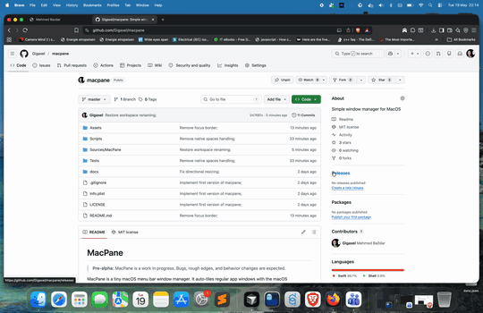

# MacPane

> **Early release:** MacPane is reasonably stable for daily use. Rough edges and behavior changes are still possible. There are no official releases yet; build the app yourself using the instructions below.

MacPane is a tiny macOS menu bar window manager. It tiles regular app windows automatically and lets you focus, swap, resize, and rotate tiles with global keyboard shortcuts.

MacPane arranges the windows on each display as soon as it launches, and keeps them arranged as windows open, close, minimize, hide, and move between displays and Spaces.

## Demo



## Shortcuts

- `Cmd+Option+Arrow` or `Cmd+Option+H/J/K/L`: focus the nearest tiled neighbor in that direction.
- `Cmd+Shift+Arrow` or `Cmd+Shift+H/J/K/L`: swap the focused window with that neighbor.
- `Cmd+Ctrl+Arrow` or `Cmd+Ctrl+H/J/K/L`: resize the split containing the focused window.
- `Cmd+Option+Z`: zoom the focused window to fill the workspace; press again to restore its tile.
- `Cmd+Option+O`: rotate the focused split between side-by-side and stacked.
- `Cmd+Option+B`: balance the splits of the focused workspace.
- `Cmd+Option+G`: float the focused window, or tile it again.
- `Cmd+Option+Y`: turn tiling off or on.
- `Cmd+Option+R`: retile now.
- `Cmd+Option+[` / `Cmd+Option+]` / `Cmd+Option+0`: shrink, grow, or reset the gap.
- `Cmd+Option+,`: open Settings.
- `Cmd+Option+A`: turn workspace switch animations off or on.
- `Cmd+Option+1...9`: switch MacPane's virtual workspace on the current display.
- `Cmd+Ctrl+1...9` or `Cmd+Ctrl+Option+1...9`: move the focused tiled window to a virtual workspace. With more than one display, a picker asks which display.
- `Cmd+Ctrl+Option+Left/Right` or `Cmd+Ctrl+Option+H/L`: switch to the previous or next virtual workspace.
- `Cmd+Ctrl+Option+=`: create a new virtual workspace and switch to it.
- `Cmd+Ctrl+Option+-`: delete the current virtual workspace when it is empty.
- `Cmd+Ctrl+Option+V`: show an overview of the virtual workspaces. While it is visible, `1...9` switches and `R` renames.

Most shortcuts can be changed in Settings under Shortcuts. The workspace number keys and the `H/L` workspace keys are fixed.

New windows split the focused tile, similar to Pop Shell and i3-style binary tiling. Closing a window gives its space back to its sibling. A minimized window, or a window of a hidden app, keeps its place and returns to the same tile. Switching tabs in a tabbed window keeps the tile too.

You can also drag a window onto another tile: dropping it in the middle swaps the two, and dropping it near an edge splits that tile. Dragging the edge of a tile resizes the split.

## Workspaces and Spaces

Each display has its own virtual workspaces. Windows on a workspace that is not showing are parked just off the corner of the display, and brought back when you switch to it. Focusing a parked window, for example with `Cmd+Tab`, switches to its workspace.

If you use native macOS Spaces, each Space on a display has its own set of virtual workspaces. Fullscreen Spaces are left alone, and a window keeps its tile while it is in native fullscreen.

When a display is unplugged, its workspaces move to a remaining display and keep their numbers. They move back when the display returns.

## Gaps

The gap around and between tiles is set in Settings, or with the gap shortcuts. The default is `8` points.

## Pop-ups and app size limits

Small new windows, such as OAuth pop-ups and pickers, float instead of splitting the focused tile. Set the size limits in Settings under "Pop-up Windows". The float shortcut tiles a floating window.

Some apps refuse to go below a minimum size. When an app holds a larger frame than MacPane asked for, MacPane gives that window the size it insists on and takes the space from its neighbors. This is worked out per window while it is open, and nothing about it is saved.

## How it works

MacPane reads window state directly from the macOS WindowServer and moves windows through the Accessibility API.

- **State comes from the WindowServer.** Any change (a window created, moved, closed, a Space switched) triggers a reconcile that re-reads the whole window list and writes only the frames that differ from the layout. A full read takes well under a tenth of a millisecond, so nothing is polled and nothing observed is kept between reconciles.
- **Accessibility never runs on the main thread.** Each app has its own queue, so an app that hangs holds up only its own windows, and hotkeys never wait on another app.
- **Private APIs.** The WindowServer queries, events, and direct window focus use the private SkyLight framework. Every symbol is looked up at launch. If the query or event calls are missing on some macOS release, MacPane falls back to the public window list and Accessibility notifications, with a once-a-second check for windows nothing announced. In that mode it cannot see native Spaces, so every Space on a display shares one set of workspaces. If only the focus call is missing, focusing goes through app activation instead.

Set `MACPANE_TIMING=1` in the environment, or `defaults write com.gigaxel.macpane timingLog -bool true`, to log timings to stderr.

## Build

```bash
./Scripts/test.sh
./Scripts/build-app.sh
```

The app bundle is written to `build/MacPane.app`.

For a stable local install, use:

```bash
./Scripts/install.sh
```

That builds and writes the app to `~/Applications/MacPane.app` by default. You can override the destination with `INSTALL_DIR=/Applications ./Scripts/install.sh`.

`./Scripts/integration-test.sh` runs the tiler against real windows that the test opens itself, once on the private WindowServer calls and once on the public fallback. It needs a logged-in desktop session and moves only its own windows.

### Signing

macOS ties the Accessibility permission to the app's code signature. The build signs with the first Apple Development or Developer ID identity in your keychain, so the permission survives rebuilds. Set `CODESIGN_IDENTITY` to choose an identity. Without one the app is signed ad hoc, and macOS asks for the permission again after every rebuild.

## Run

```bash
open build/MacPane.app
```

On first launch, macOS will ask for Accessibility access. If the prompt does not appear, open System Settings, go to Privacy & Security, then Accessibility, and enable MacPane. MacPane starts tiling within a second of the permission being granted.

## Accessibility Troubleshooting

If macOS keeps asking after you grant access, it is usually because a rebuilt ad-hoc signed app replaced the copy that macOS trusted (see Signing above). Fix it by installing one stable app bundle, then granting permission to that bundle:

```bash
./Scripts/install.sh
open ~/Applications/MacPane.app
```

If there is already a stale MacPane entry in Privacy & Security, remove it from Accessibility and add the newly installed `~/Applications/MacPane.app`. You can also reset only MacPane's Accessibility entry:

```bash
tccutil reset Accessibility com.gigaxel.macpane
```

After resetting, launch the installed app again and grant Accessibility once.

MacPane is a menu bar app, so it does not show a Dock icon or main window.

## License

MacPane is available under the MIT License. See [LICENSE](LICENSE).
